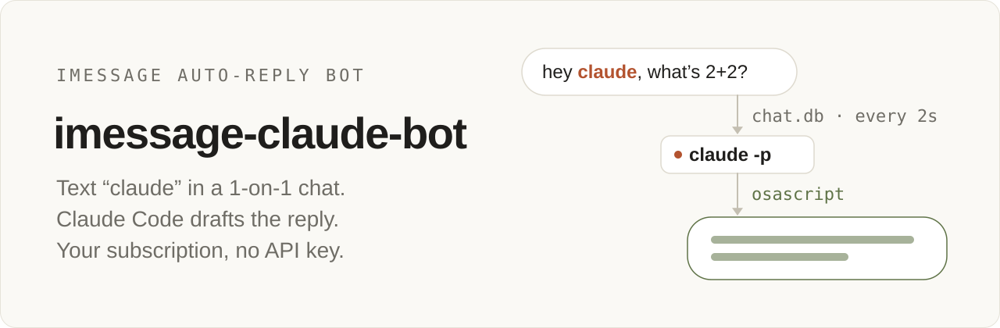
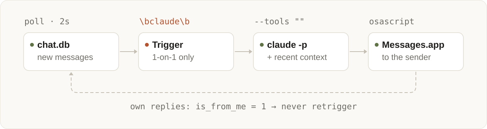

<div align="center">

<picture>
  <source media="(prefers-color-scheme: dark)" srcset="assets/hero-dark.svg">
  
</picture>

<br>


</div>

iMessage auto-reply bot powered by the Claude Code CLI.

Receive a message containing the word **claude** in any **1-on-1** iMessage chat, and Claude Code (your subscription, no
API key) drafts a reply that gets sent back automatically.

> Last updated: 2026-04-16

## How it works

<picture>
  <source media="(prefers-color-scheme: dark)" srcset="assets/flow-dark.svg">
  
</picture>

<details>
<summary>Plain-text version</summary>

```
iMessage arrives
   ↓ (chat.db poll, 2s)
match "\bclaude\b" in text, is_from_me = 0, 1v1 only
   ↓
fetch last 3 user messages in same chat (context)
   ↓
claude -p --tools "" --effort medium --model opus ...
   ↓
osascript → Messages.app → send to original buddy
```

</details>

The bot's own replies have `is_from_me = 1`, so they never retrigger the trigger word loop.

## Scope and limits

- **1-on-1 only.** Group send via AppleScript is broken on macOS 14+. If you need groups, run a
  [BlueBubbles](https://github.com/BlueBubblesApp/bluebubbles-server) server and adapt `send_imessage()`.
- **Text column only.** macOS 14+ stores some messages in `attributedBody` (a binary plist). Those are silently skipped: the
  trigger word needs to land in `text`. Good enough for plain typed messages.
- **No rate limit.** Replies fire as fast as `claude -p` returns. Your Claude Code subscription has a 5-hour rolling cap: if
  a group of friends start spamming the trigger word, it can burn through fast. Add a guard back if you need one.
- **No tool use.** Replies are pure text; the model can't browse or run code. Tweak `SYSTEM_PROMPT` and the `--tools` flag
  in `bot.py` if you want otherwise.

## Setup

### 1. Permissions (one-time, manual)

macOS will block the bot until you grant two TCC permissions.

| Permission | Needed to | How |
|:--|:--|:--|
| **Full Disk Access** | Read `~/Library/Messages/chat.db` | System Settings → Privacy & Security → **Full Disk Access** → add `/usr/bin/python3` (and your terminal app, if testing from there). |
| **Automation → Messages** | Send replies | The first time the bot calls `osascript`, macOS prompts to allow Terminal/Python to control Messages. Approve it. To revoke or re-check: System Settings → Privacy & Security → **Automation**. |

### 2. Verify the backend works

```bash
echo "say hi" | claude -p --tools "" --no-session-persistence
```

You should get a short reply on stdout. If not, fix that first: nothing else matters until `claude -p` works.

### 3. Install as a LaunchAgent

```bash
./install.sh
```

This writes `~/Library/LaunchAgents/com.user.imessage-claude-bot.plist`, loads it, and starts the bot. It will keep running
and auto-restart on crash.

Verify:

```bash
launchctl list | grep imessage-claude-bot
tail -f ~/.config/imessage-claude-bot/bot.log
```

### 4. Test it

From your iPhone (or another Mac), text yourself something like:

> hey claude, what's 2+2?

Within a few seconds you should see a reply.

## Uninstall

```bash
./uninstall.sh
```

Removes the LaunchAgent. State (`~/.config/imessage-claude-bot/`) is left in place: delete it manually if you want a clean
wipe.

## Tuning

Edit the constants at the top of `bot.py`:

| Constant | Default | What it does |
|:--|:--|:--|
| `POLL_INTERVAL_SEC` | `2.0` | How often to check chat.db |
| `TRIGGER_RE` | `\bclaude\b` (case-insensitive) | Trigger pattern |
| `CONTEXT_MESSAGES` | `3` | Recent user messages included as context |
| `CLAUDE_TIMEOUT_SEC` | `90` | Per-call timeout |
| `SYSTEM_PROMPT` | (see file) | Prepended to every call |
| `CLAUDE_BIN` | `~/.local/bin/claude` | Absolute path to the `claude` CLI binary |

After changing, reload:

```bash
launchctl unload ~/Library/LaunchAgents/com.user.imessage-claude-bot.plist
launchctl load   ~/Library/LaunchAgents/com.user.imessage-claude-bot.plist
```

## Troubleshooting

- **"attempt to open a readonly database" / sqlite errors.** Full Disk Access not granted to `/usr/bin/python3`.
- **Nothing happens when I text "claude ...".** Tail `bot.log`. Common causes: the message landed in `attributedBody` (text
  column NULL, see [Scope and limits](#scope-and-limits)), the bot is in a group chat (skipped by design), or the `claude`
  CLI is not at `~/.local/bin/claude` (update `CLAUDE_BIN` in `bot.py`).
- **Bot replies feel slow.** `claude -p` cold-start is a few seconds. Drop `--effort` from `medium` to `low` in `bot.py` for
  snappier (but shallower) replies.
- **Bot replies to my own outgoing messages.** Shouldn't happen (`is_from_me = 0` filter). If it does, file an issue with a
  `bot.log` excerpt.
